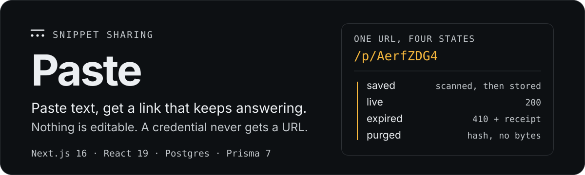

<p align="center">
  
</p>

<p align="center">
  <a href="https://paste-tawny.vercel.app"><strong>Live app</strong></a>
  &nbsp;·&nbsp;
  <a href="#a-credential-never-gets-a-url">Secret scanning</a>
  &nbsp;·&nbsp;
  <a href="#the-url-outlives-the-bytes">410 receipts</a>
  &nbsp;·&nbsp;
  <a href="#getting-started">Getting started</a>
</p>

Paste text, get a permanent link. The bytes behind that link are never rewritten — only
superseded by a new revision, or destroyed on the schedule you chose when you saved. No
account is needed to create one.

Two decisions separate this from the other paste bins, and both are visible in the
screenshots below.

## A credential never gets a URL


220 compiled rules run **before** the insert, not after it. A tier-1 finding writes zero
rows — no paste, no id, nothing to retract — and the same rules run again server-side on
save, so the in-browser check is a convenience rather than the control.

Scanning after publication would leave a window in which the credential is live on the
internet, and the only remedy left is rotation. The finding's preview keeps four characters
at each end and never the secret itself: a table of extracted credentials is a better
target than the pastes they came from.

## The URL outlives the bytes


An expired paste answers **410 Gone** with a receipt: who made it, when, how large it was,
and the SHA-256 of the bytes that were destroyed. Anyone holding a local copy can prove it
is the same text. A lapsed link becomes a record, not a typo.

Retention is picked before saving and there is no delete button afterwards. That is the
trade: you choose how long it lives while you still have the context to choose well, and
nobody — including the author — can quietly rewrite what a link resolved to.

## How it works

- **Highlighting runs once, at save time.** Shiki renders to HTML when the revision is
  written, not on every view. A per-request highlighter would pay the 70 ms WASM warm-up
  repeatedly; the figures are in [Measured thresholds](#measured-thresholds).
- **Revisions are immutable in the database, not by convention.** A Postgres trigger
  refuses every column change except `purged_at`, so the one legal mutation is destroying
  the bytes. Claiming a guest paste moves its ownership and leaves its authorship alone,
  because a guest really did write it.
- **The id is unguessable, because it is the access control.** Eight base58 characters from
  `crypto.randomBytes` — an unlisted paste is protected by the id alone, so a sequential
  one would make every paste enumerable.
- **Rate limits are charged on attempts, not successes**, and keyed on the account or, for
  anonymous callers, a salted hash of the caller's address. An unsalted hash of an IPv4
  address is reversible by enumeration, not anonymous.

## Getting started

```bash
pnpm install
pnpm dev
```

Then open **http://localhost:3025** — not 3000, which another project in this workspace
occupies. Port 3000 answering does not mean it answered as this app.

`pnpm dev` regenerates three artifacts first: the Prisma client, the fixture renders and the
compiled secret rules. None are committed, so a fresh clone needs the one command rather
than a documented sequence.

One origin, one port. An inline `/raw/:id` used to need a second one — bytes a browser
renders are a content-type mistake away from being a page, and a page on the app's origin
runs with the reader's session, so a separate registrable domain was required to hold it.
`/dl/:id` sends the same bytes as an attachment instead: the browser saves rather than
renders, so there is no origin for a script to run in and nothing to isolate.

### The database

The first five milestones run on fixtures and need no database. After that:

```bash
cp .env.example .env     # then fill in the two connection strings
pnpm db:deploy           # apply migrations
pnpm db:status           # confirm
```

> [!WARNING]
> **`pnpm db:deploy` only.** Never `prisma migrate dev` and never `migrate reset`. This
> project shares one Supabase project with the workspace's other apps, and development and
> production share the `paste` schema inside it. Both commands can drop data that is live,
> and there is no staging copy to rehearse against — a destructive migration needs a manual
> backup first.

Two details that are easy to get wrong, both explained in `.env.example`:

- The connection strings go in `.env`, **not** `.env.local`. The Prisma CLI does not read
  `.env.local`, so splitting them gives you a working app with a failing migration.
- `DIRECT_URL` carries `?schema=paste` and `DATABASE_URL` does not. That parameter decides
  which schema holds `_prisma_migrations`; without it, this app and its sibling share one
  ledger and each reads the other's migrations as missing.

`immutability.spec.ts` and `rls.spec.ts` run against the real database inside a transaction
that is always rolled back. Without `.env` they skip and print why. `CONNECTIONS.md` has
the pooler arithmetic, which is worth reading before raising the test worker count.

## Measured thresholds

The numbers behind `src/lib/render/thresholds.ts`. **Reproduce them with
`pnpm measure:thresholds`** — the script is committed, and every figure below is its output
on an Apple-silicon laptop with Shiki 4.6, the CSS-variables theme and the style-to-class
transformer.

The script exists because the original numbers did not survive contact with a
re-measurement. They recorded an output without its input, so there was no way to tell a
regression from a different test body — and they were 2–3× off. **A measurement you cannot
re-run is a claim, not evidence.**

### Shiki, highlighting at save time

Cold start, the first highlight in a process: **70 ms**. That is WASM and grammar warm-up,
paid once. A per-request highlighter would pay it on every view.

| lines   | language   | wall clock | HTML    | bytes/line |
| ------- | ---------- | ---------- | ------- | ---------- |
| 200     | TypeScript | 34 ms      | 118 KB  | 604        |
| 2 000   | TypeScript | 309 ms     | 1.2 MB  | 604        |
| 20 000  | TypeScript | 2 747 ms   | 11.5 MB | 604        |
| 100 000 | TypeScript | 13 415 ms  | 57.6 MB | 604        |
| 200     | plain text | 0 ms       | 21 KB   | 105        |
| 2 000   | plain text | 8 ms       | 205 KB  | 105        |
| 20 000  | plain text | 35 ms      | 2.0 MB  | 105        |
| 100 000 | plain text | 190 ms     | 10.0 MB | 105        |

The TypeScript rows repeat one deliberately dense line — a generic, a string literal and a
trailing comment. As a control, the largest TypeScript file in this repo measured as itself:
**342 lines, 57 KB of markup, 171 bytes/line, 110 ms.**

**What these numbers settled, and what they changed.**

_The DOM is the constraint, and a line count cannot express it._ This is the finding that
changed the code. The same language at the same line count measured 171 bytes/line as real
code and 604 as dense code — a 3.5× spread, so 2 000 lines is anywhere between 348 KB and
1.2 MB of HTML. The design had accepted 688 KB. No choice of line count is right for both
ends of that range, because the quantity being bounded is not a function of the input the
gate can see. So `MAX_RENDER_BYTES` caps the **markup**, checked after rendering by both
writers, and the line and byte gates were demoted to what they honestly are: a cheap
refusal to start work that would be discarded anyway.

_Checking the output is affordable only because rendering already happens at save time._ The
cost of a refused render is one wasted highlight on a save that still succeeded, and the
reader falls back to escaped text with a banner — a path that already existed for a missing
render. On a read path this check would be impossible.

_Cost is superlinear past the cutoff._ 200 → 2 000 lines is 9× the work for 10× the lines;
2 000 → 20 000 is 9× again; 20 000 → 100 000 is 4.9× for 5× the lines, but 13.4 seconds in
absolute terms. The 2 000-line rung is where highlighting stops being bookkeeping and
becomes a visible pause on a save, which is why the gates stay where they are even though
they are no longer the real limit.

### The scanner

| body             | rules after keyword prefilter | wall clock |
| ---------------- | ----------------------------- | ---------- |
| 256 KB of code   | a handful                     | ~22 ms     |
| 256 KB of filler | a handful                     | ~33 ms     |

Comfortably inside the 150 ms budget. The keyword prefilter is what buys it: most bodies
never run most of the 220 compiled rules.

## Before changing anything

Read **`AGENTS.md`**. Several things here are deliberately not the Next.js defaults, and it
records which ones and why. `DESIGN.md` carries the visual system, including what is
deliberately not animated.

The architecture and build-order documents are kept outside this repository, so the paths
they occupy locally are not part of a clone.
